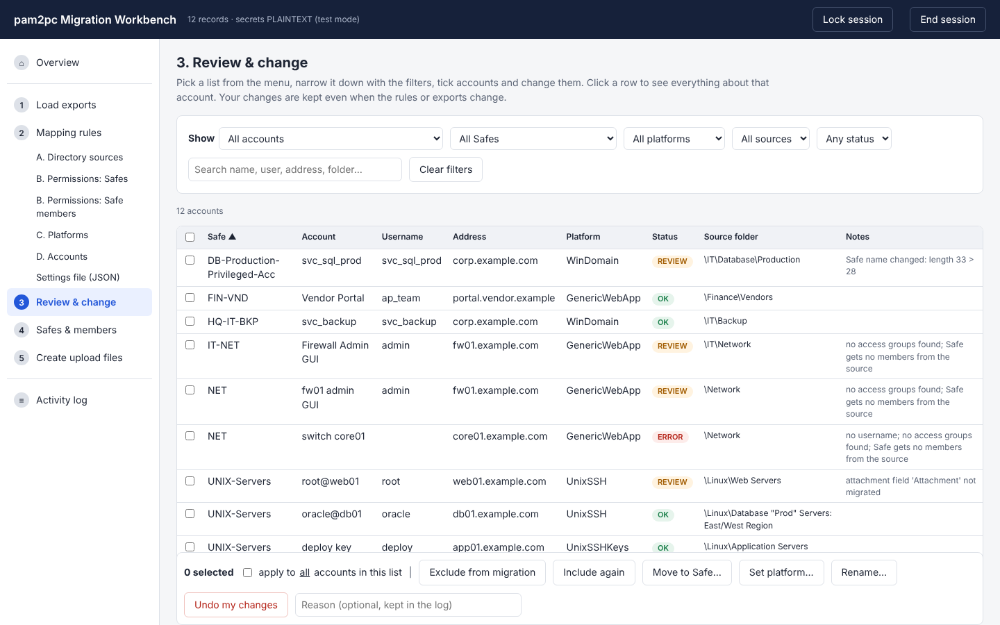
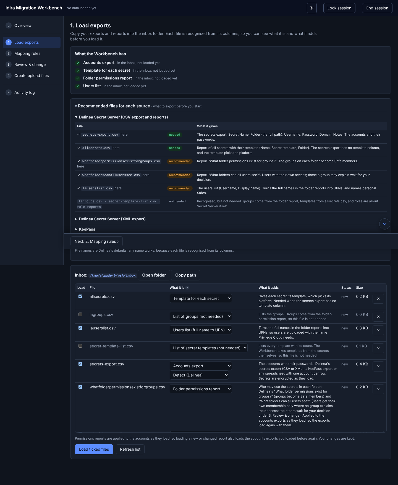
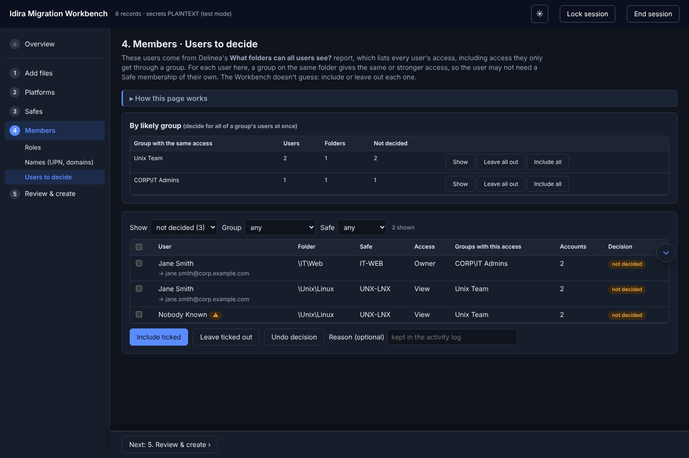

# Idira Migration Workbench: PAM exports to Privilege Cloud upload files

`Idira Migration Workbench` is an **offline** converter. It reads credential exports from other PAM tools and password managers and turns them into CSV files ready to load into CyberArk Privilege Cloud through its REST API. It makes **no network connections** to the source or to Privilege Cloud. Its job is the heavy lifting of a migration: mapping, cleaning and validating the data.

```
  export files ──► source adapter ──► common model ──► rules ──► review/   (no secrets, shareable)
  (Delinea, KeePass,                   (accounts,      (Safes,     upload/   Safes.csv
   CSV, Excel...)                       grants)         platforms,           SafeMembers.csv
                                                        members,             Accounts.csv
                                                        checks)
```

The Workbench is one Windows program, `IMW.exe` (about 52 MB, .NET 10 built in, nothing to install). **Download:** [IMW-win-x64.zip](https://github.com/Shvian/IMW/releases/latest/download/IMW-win-x64.zip), rebuilt from `main` on every change. It holds `IMW.exe`, `start-ui.cmd`, this README, `START HERE.txt` and a sample workspace with fake data; unzip it and double-click `IMW.exe`. Every push to any branch also builds the same files on GitHub (Actions, workflow *Windows app*, artifact `IMW-win-x64`). To build it yourself on any computer with the .NET 10 SDK: `dotnet publish dotnet/src/Imw -c Release -r win-x64 -o dist`. The code is C# in `dotnet/` (IMW = Idira Migration Workbench). It was called `pam2pc` (and the project D2P) before: a workspace folder still named `pam2pc_workspace` next to it is picked up automatically, and the environment variables are `IMW_UI_TEST_PASSWORD` and `IMW_UI_NO_OPEN`. The first versions were written in Python; databases, workspaces and settings files from them still work, and regular expressions in the settings use the same (Python-style) syntax.

## Easiest: the Idira Migration Workbench (menus, no SQL)

Double-click `IMW.exe` (it starts the Workbench on the `imw_workspace` folder next to it), or run `IMW.exe ui` (options such as `--workspace` go after `ui`, or after `start-ui.cmd`). A page opens in your browser over HTTPS. **Sign in with your Windows password first**: only the Windows user who started the Workbench can unlock it, and Windows itself checks the password (nothing is stored).

The **Overview** opens first. It lists the four steps with the state of each (for example "2 record types have no platform yet", "63 accounts have errors" or "3 users may get their access through a group") and a **Next** button on the step to do now, plus count tiles (will be uploaded, need a look, errors, left out by you, Safes, your changes) that each open their list. The left menu shows the four steps and the Activity log; the pages of a step appear under it while you are in that step.

1. **Load exports.** Copy the exports and reports into `imw_workspace\inbox` (click the path to open it in Explorer). Each file is recognised from its columns, and **What it is** says so: an accounts export (with its source), a folder permissions report, the template for each secret, the users list, or **Not needed** for reports the Workbench doesn't use (Delinea's groups list, template list and role reports). Change it if the guess is wrong; the tooltip says what each kind is for. A checklist card shows which of the usual Delinea files are there and loaded, and **Recommended files for each source** (folded) lists what to export from Delinea (CSV export and reports, or the XML export), KeePass and spreadsheets, marking the files already in the inbox. Everything that is needed is ticked; click **Load ticked files**. Several permissions reports are merged. Each file shows whether it is **loaded**, **changed since loaded** or not loaded yet, and loaded files are no longer ticked, so they are not loaded twice by accident. Secrets are encrypted as they load; **Securely delete the loaded exports** then removes the exports in one go (the ✕ on a row deletes one file). **Loaded so far** lists every loaded file with its SHA-256 checksum and marks a file loaded more than once as the same or different content. Loading a file with the same name again replaces its records (matched by record ID) and keeps your changes; loading the same content under another name loads every record twice. Invisible and control characters (zero-width spaces, line breaks inside a name) are removed as records load, and the Overview counts the accounts this touched. If a spreadsheet loads with no username or no address in any row (its headers aren't ones the Workbench knows, such as `SAMAccountName` or `TargetHost`), a **Which column holds what** card lists its columns: pick the column for each field and click **Save and load again**. The choice is saved as `sources.table.columns` and used for every spreadsheet after that.
2. **Mapping rules**, one page per topic. Each settings page shows the default first and its **Exceptions** at the bottom, and has its own **Save & apply** that saves only that page (it reads **Saved** while there is nothing new to save).
   - **A. Safes.** The Safe name (from the folder structure by default, with the name patterns), **Codes used in names** (folder abbreviations, other words, placeholders such as `{env}`; folded, since most migrations leave them alone), the Safe settings for every Safe (CPM, description, retention by versions or days, automatic CPM management), then the exceptions: send a folder to another Safe, Safes from access groups (role-oriented, empty by default), and different settings for some Safes. Its preview lists every source folder with the Safe its accounts go to and that Safe's CPM, retention, description and notes.
     **Personal Safes**: a folder that holds one person's secrets, such as Delinea's `\Personal Folders\Jane Smith`, would otherwise become a Safe named from abbreviations of the person's name (`PRS-FLD-JANE-SMT`). Mark the personal folders here (the page offers **Mark \Personal Folders as personal** when your folders have one). With no person given, each folder directly under the marked one is one person's, named after them; give a person to mark one folder as theirs. Everything under a person's folder goes to their Safe, named with the **Personal Safe pattern** (`P-{user}` by default): `{user}` is the username (the UPN before the @, taken from the users list), `{upn}` the whole UPN, `{first}` and `{last}` the names ("Smith, Jane" works too) and `{name}` the folder name. A person who isn't in the users list is flagged and named from the folder. **Add the person to their Safe as** (Full by default; empty to leave it to the reports) makes each person a member of their own personal Safe. The folder permission reports should show them on their folder too: the member's notes say which permission the report gives ("the folder report gives it Owner"), or say CHECK when the reports for that folder don't list the person; a person's access to their own folder is never held under Confirm user access. Settings: `personal_safes` (`template`, `owner_role`, `folders: [{"folder", "person"}]`); example in `samples/personal_safes/`.
     **Accounts without folders** (open when your loaded accounts have none, for example a plain spreadsheet): pick a column such as Site or Application, or the address's domain, and **Add to the Safe name**. The Workbench lists the column's values, suggests a 1-4 letter code for each (Boston becomes BOS, Production P), adds a placeholder such as `{site}` with one row per value, and puts it into the pattern for accounts with no folders (`{env}-{site}-{tech}-{flavor}-{acct}` gives `P-BOS-SVR-WIN-LA`). Codes that clash are flagged, and the card says how many Safes you get and how big the biggest is. Step 4 writes the parts of every Safe name to `review/SafeNamingConvention.csv`. Next to the account limit, **split them into numbered Safes** spreads a Safe over the limit across `-01`, `-02`... Safes of about the same size, sorted by address.
   - **B. Safe permissions.** Source permission to role, with the Privilege Cloud presets and your own custom roles. **Standard member groups for each Safe** gives Safes members when the source has no permissions: rows such as `{safe}-Owners` (Full), `{safe}-Users` (Connect only) and `{safe}-Approvers` (Approver), one click away with **Use the suggested set**, named after each Safe's final name. By default they go only on Safes that get no members from the source; they can go on every Safe or be switched off. A row without `{safe}` adds that one member everywhere. Names go through C. Safe members like any other member, and a group name Active Directory would refuse (over 64 characters, or `" / [ ] : ; | = , + * ? < >`) is flagged.
   - **C. Safe members.** How each group, user and role becomes a Safe member: the default for every member (searchIn, drop the domain), domain conversion (drop a domain, or change it and give the name in UPN format `name@domain`, for any number of source domains: each to its own output domain or several to one), a preview of every member as it will be uploaded, then the exceptions: sources with their own name rules (find and replace, add text before or after, change case) and searchIn.
   - **D. Platforms.** The platform for each record type and the default platform, then the exceptions: platform rules, which are checked first. A record type with no platform is marked **needed**. Platform ID boxes offer a list of the usual Privilege Cloud platform IDs plus the ones you already use, and platform rules can look at any other column of your export. Common Delinea templates (Windows Local Admin, Active Directory Domain Admin, Cisco Account (SSH), Palo Alto, VMware ESXi, PostgreSQL, MySQL, AWS IAM Key, Azure AD Account) are mapped out of the box; check the IDs against Platform Management in your tenant.
   - **E. Accounts.** How accounts are named, URL addresses, and extra account properties (the source column box lists the columns found in your loaded exports).
   - **Matching text.** Wherever a rule compares text (placeholder values and Safe settings on A, platform rules on D, Find on C, access-group patterns), a picker before the box chooses **Contains**, **Starts with**, **Ends with**, **Equals** or **Regex (advanced)**, so most rules need no regular expressions; the Workbench writes the pattern for you. Upper and lower case are always ignored. A pattern saved earlier opens in the simplest form that means the same, or as Regex. Under **Safe from access groups**, each row shows which access group in your data it matches first and the Safe name that gives, with what `{1}`, `{2}` stand for.
   - **Floating preview.** Every rules page has a **Preview** that floats at the bottom of the window above Save & apply (fold it with its arrow; scroll inside it; drag its corner to make it taller). It runs the full rules on everything loaded with the settings as they are on the page, updating as you type, before anything is saved. The source columns are on the left and the upload CSV columns they become are on the right: folders → Safes.csv (with CPM) on A, members and permissions → SafeMembers.csv roles on B, members → MemberName and SearchIn on C, record types → PlatformId on D, records → Accounts.csv names and properties on E. Cells your unsaved changes affect are highlighted, and "only rows my changes affect" narrows the list to them.
   - **Advanced: settings file (JSON)**, linked at the bottom of every rules page, for anything else.

   Every page has a folded **How this page works** where it needs one; every input has a tooltip that explains it and its syntax. Input tables with many rows start folded (click the row or **Edit**); an empty one shows **+ Add**. **Save & apply** and **Next** float at the bottom of the window; a round down-arrow button at the bottom right shows when there is more of the page below. Safe names, platform IDs and account names warn as you type when they hold characters Privilege Cloud doesn't allow.
3. **Review & change**, in three parts:
   - **A. Safes & members**, with a tab for each (and a third, **Confirm user access**, when the folder report has users to confirm; see below). **Safes** lists the Safes the upload will create with their accounts, members, CPM, retention and description; a Safe whose name was changed to fit Privilege Cloud is marked. A Safe that will be uploaded but has no member with full permissions (the **Full** role, or a custom role with every Full permission) is flagged **no full member** (or **none** when it has no members at all), with a note at the top and **show only these Safes**: after the upload nobody from your source could manage it or its members. Click a Safe to open its side panel: how it was named, and under **Name and settings** you can rename that one Safe or set its description, location, managing CPM, how long it keeps passwords (versions or days), OLAC and auto purge. Empty fields keep what the rules give (shown in grey); your values always win over the rules, survive re-running them, are listed under **Your Safe changes** with an Undo button, and the Safe's accounts and per-Safe member changes move with a rename. Renaming a Safe to another Safe's name puts both into one Safe with that Safe's own settings; its panel lists the Safes renamed into it, each with **Split back out**, which moves back only that Safe's accounts and the member changes that came with it. Invisible or control characters typed into Safe settings, member names or searchIn are removed, and the page says so. Below that you see its members and change each one's role or take it off. Tick Safes and the **add a member** and **remove a member** boxes appear. **Members** has one row per user, group or role, including members from the export that are on no Safe (because their accounts are not uploaded). Click a member to see every Safe it is on, change its role per Safe, add it to another Safe, or change its memberName, memberType (User, Group or Role) and searchIn everywhere. **Your member changes** lists them with an Undo button; they survive re-running the rules.
   - On both review pages, **Columns: Source → upload CSV** shows what the export had on the left and the Safes.csv, SafeMembers.csv or Accounts.csv columns it becomes on the right (secrets are never shown).
   - **B. Accounts & platforms.** Pick a list (Needs a look, Errors, Forbidden characters changed, Safe name was changed, No access groups, Possible duplicates, One-time password in the source, Changed by you...), search it, or narrow it under **Filters**. Each account shows why it needs a look in its own column. Those reasons are about the account itself; notes about its Safe (no access groups, a Safe name shortened or cleaned, a Safe shared by several folders) are on **A. Safes & members** instead. When you have looked at an account that needs a look and it's fine, tick it and choose **✓ Approve** (or use the button in its side panel): it keeps the "Needs a look" label with a green tick, and the lists "Needs a look, not approved yet" and "Needs a look, approved by you" separate them. An approval lasts only while nothing about the account changes: if its notes, Safe, platform, name, address, username, folder or Migrate value change later (by a rule, an edit or a new export), the approval is dropped and the account needs a look again. Approvals, removals and dropped approvals are in the activity log. Tick accounts (or **Select all** in the list) and the actions appear: move them to another Safe, give them another platform or `(none)` for no platform, leave them out or include them again, and under **More actions** rename one, let Privilege Cloud name them, or undo your changes. You can add a reason, which goes into the log. Click a row to open that account in a side panel: why it needs a look, where it goes and where each value came from, and you can change its Safe, platform, name (or let Privilege Cloud name it) and whether it migrates, or undo any one of your changes.
   - **Confirm user access** (a tab of A. Safes & members). Delinea's *What folders can all users see?* report lists every user's access, including access they only get through a group. A user whose access is stronger than every group's on that folder, or who is on a folder no group can see, is added as a Safe member on its own (noted "direct access"). Every other user is listed on this tab, because a group on the same folder gives the same or stronger access and the user is probably a member of it. The Workbench doesn't guess: choose **Add as member** or **Rely on the group** for each user in the Decision column, for all of a group's undecided users at once under **By likely group**, or for the ticked users (filter by group or Safe), with an optional reason for the activity log. Your choices are marked "not saved" until you click **Save decisions** at the bottom of the window; leaving the page first asks. Users with no decision are not uploaded, step 4 warns until none are left, and `review/Users_To_Decide.csv` lists them. Decisions are kept per folder and user, so they survive loading the files again. Full names from the report become UPNs through the users list (`lauserslist.csv`); a name that isn't in it, or is in it twice, is flagged.
4. **Create upload files.** The **Ready check** tiles come first (each opens its list). Choose everything or one wave (by Safe, platform or source), and a dry run or upload-ready. The folder name is filled in for you (for example `2026-11-13-all-dryrun`); type over it if you like. Upload-ready needs you to type a confirmation. Every set of files includes `review/SafeNamingConvention.csv`: the parts of every Safe name the upload creates (column var1 every first part, var2 every second part...), so new Safes can be named the same way once Privilege Cloud is live. Old upload files can be securely deleted from the same page.


**Look and safety.** The Workbench opens in dark mode; the ☀ button in the top bar switches to light (remembered in that browser). If you typed changes on a settings page or in a side panel and haven't saved them, leaving the page, closing the panel or closing the tab asks first. **Security and data handling** (open on the first start, folded on the Overview afterwards) explains in plain words how the Workbench is built and protects your data.

The **Activity log** page shows the latest entries as plain sentences (for example "Loaded keepass_export.xml: 60 records as KeePass"), a folded summary by action and person, and exports the whole log and every account change as CSV.







**Locking and ending.** After 10 minutes without activity, or when you click **Lock session**, the page goes back to the sign-in screen. **End session** explains what it does and ends with one click on its button: it stops the Workbench, and the database stays on disk, encrypted for your Windows account, until you start the Workbench again and sign in. Tick the box in that pop-up to securely delete the database as well; that needs you to type DELETE DB. Output files and the inbox are kept either way.

**Only the Windows user who created the workspace can use it.** The first start records you as the owner of the workspace folder and its database, and sets the folder's permissions so that only you (and SYSTEM) can open anything in it: the inbox exports, the database, the config and the outputs. Inherited permissions are removed, so other users of the machine, including administrators, can't read the files without taking ownership (which needs admin rights and leaves a trace in Windows). Another user who starts the Workbench or the command line on your workspace or database gets a "belongs to" message and nothing opens. While the Workbench runs, it also checks which Windows user owns each browser connection and refuses everyone but you, because `127.0.0.1` is shared by every session on the machine. A workspace must be a new or empty folder (or an existing Workbench workspace), because its permissions are locked down.

**HTTPS.** The page is served over HTTPS with a certificate the Workbench makes on the computer it runs on, the first time it starts (RSA 2048, 397 days). Its subject is the computer's name, and its alternative names (SAN) are the computer's full DNS name and host name, `localhost`, `127.0.0.1` and `::1`. If the computer is renamed, a new certificate is made at the next start. It is kept in `<workspace>\tls\`, with the private key encrypted by DPAPI for your account. The browser warns once because the certificate is self-signed: choose Advanced, then Continue. To stop the warning, start once with `IMW.exe ui --trust-cert`, which adds the certificate to your own Windows user's Trusted Root store (Windows asks you to confirm). `--new-cert` makes a new one; `--no-tls` serves plain HTTP for troubleshooting only. The start-up window prints the certificate's SHA-256 fingerprint.

The page is served only to this computer (`127.0.0.1`), through a one-time link that becomes a Secure, HttpOnly session cookie. Five wrong passwords in a row add a growing wait, and every sign-in, lock and failed attempt is logged. Your Windows account lockout policy also counts failed attempts. No page ever shows a secret. The UI runs as you, so DPAPI works the same as on the command line. Everything lives in the workspace folder: `migration.db`, `config.json`, `inbox\` and `output\`. More screenshots are in [docs/ui](docs/ui).

Sign-in needs Windows. For automated tests on other systems, set `IMW_UI_TEST_PASSWORD`; never use that with real data.

## Command line

**The staging database.** Load the exports once into an SQLite file on the migration host. Work on the data there with rules, edits and SQL queries, then extract upload files whenever you need them, all at once or in waves.

```
IMW.exe init-config my_config.json                       # starter config to edit

IMW.exe ingest  --db migration.db -i export.csv -p permissions.csv -p more_permissions.csv -i vault.xml
IMW.exe ingest  --db migration.db -i secrets-export.csv -i allsecrets.csv --reference lauserslist.csv \
                      -p whatfolderpermissionsexistforgroups.csv -p whatfolderscanalluserssee.csv     # Delinea reports
#   -> secrets are encrypted with Windows DPAPI as they are stored; securely delete the exports now
IMW.exe map     --db migration.db -c my_config.json      # apply the rules (rerun after config changes)
IMW.exe query   --db migration.db --report list          # built-in reports
IMW.exe query   --db migration.db --report invalid-safes
IMW.exe query   --db migration.db "SELECT target_safe, COUNT(*) FROM accounts GROUP BY 1"
IMW.exe set     --db migration.db --where "folder LIKE '\Unfiled%'" --migrate N --reason "out of scope"
IMW.exe set     --db migration.db -r delinea:export:1042 --safe "APP-Payments" --platform WinDomain
IMW.exe set     --db migration.db --from-review edited/Accounts_Review.csv
IMW.exe extract --db migration.db -o wave1 --where "target_safe LIKE 'WIN-%'"                     # dry run
IMW.exe extract --db migration.db -o wave1 --where "target_safe LIKE 'WIN-%'" --include-secrets --force
```

**One-shot: `convert`.** This does everything in memory in a single command and keeps nothing between runs. It's handy for quick looks and small jobs.

```
IMW.exe convert -i export.csv -p permissions.csv -c my_config.json -o run1          # dry run
IMW.exe convert ... -o run2 --overrides run1/review/Accounts_Review.csv --include-secrets
```

## The staging database

`ingest` creates the database on first use. Run it again to add more exports. Re-ingesting the same file replaces its records, matched by `Record_ID`, and your edits are kept. Records that are gone from the new export are not deleted.

| Table / view | Holds |
|---|---|
| `inputs` | Every file ingested, with its SHA-256, who loaded it and when. |
| `records`, `grants` | The common model of every record and its access grants. `secret_enc` holds the **DPAPI-encrypted** secret. |
| `edits` | Your deliberate changes to `migrate`, `target_safe`, `platform_id` and `account_name`, with who made them, when and why. Edits survive re-ingest and re-map. |
| `accounts` (view of `plan_accounts`), `plan_safes`, `plan_members` | The result of the last `map`: the same columns as the review CSVs. |
| `audit` | Every ingest, map, set and extract, with the user, host and time. |

- `set` re-runs the mapping straight away with the config from the last `map`.
- `query` opens the database **read-only**: it cannot change data or attach other files, and `secret_enc` always reads as NULL.
- `extract --where` limits the *upload* files to a wave. The review files always cover every record. Name suffixes and collisions are worked out across the whole database, so the waves never conflict with each other.

**How the secrets are protected.** Each secret is encrypted with Windows DPAPI (`CryptProtectData`, called through `ctypes`, so no install is needed). Only the **same Windows account on the same machine** can decrypt it. Each value is also bound to a random salt for this database and to its own `Record_ID`, so a copied value won't decrypt in another database or another row. The database file holds no plaintext. Practical consequences:
- Run `ingest` and `extract --include-secrets` as the same Windows account, on the migration host. A copy of the database taken elsewhere, or used by another account, exposes metadata only.
- If that Windows account or its profile is lost, the secrets are lost too. Keep the original exports offline under your normal controls until the migration is signed off, or be ready to export again.
- On Linux or macOS there's no DPAPI. There, `ingest` needs either `--no-secrets` (metadata only) or `--insecure-plaintext-secrets` (test data only).

You can pass several `-i` files in one run, including files from different sources (for example a Delinea export plus a KeePass vault plus a spreadsheet). The tool detects the format of each file. To force one, prefix the path with the source name: `-i keepass=vault.xml`, `-i table=inventory.xlsx`.

## Supported sources

| Source | Files | Notes |
|---|---|---|
| `delinea` | Delinea / Thycotic Secret Server **CSV** export, or **XML** export / import file | CSV: handles the multi-template export, with one header row per template and an optional template-name line above each. Quoted multi-line values work. Access groups come from `--permissions`. XML (`<ImportFile>`, Secret Server's Advanced Import/Export format, also what Delinea's KeePass migration tool writes): folders, templates, secrets and permissions are all read. Template fields flagged `ispassword` are secrets whatever their name and never reach `review/`; `isfile` fields are attachments and are not migrated. A secret with an empty `<Permissions>` inherits its folder's, and a folder with an empty one inherits its parent's, as in Secret Server; a secret with no permissions anywhere above it can still get them from `--permissions`. UTF-16 files (with or without a byte order mark) and files that declare `utf-16` but are really UTF-8 both load. The template becomes the record type in both formats. |
| `keepass` | KeePass 2.x **XML** export, KeePass / KeePassXC **CSV** export | Groups become folders. The entry's URL is kept as the address; with `url_address_to_host` (on by default) mapping turns it into the host name, so turn it off for web platforms that need the full login URL. The Recycle Bin, entry history and attachments are skipped, and an `SSH Private Key` field makes the entry a key account. Encrypted `.kdbx` files are not read: export to XML in KeePass first (File > Export > KeePass XML (2.x)). |
| `table` | Any **CSV / TSV / Excel (.xlsx)** sheet, one account per row | Columns are found by name through `field_aliases`, or you name them in `sources.table.columns`. Access can be one column (`CORP\Admins=Owner; CORP\Helpdesk=Read`) or a group column plus a permission column with one grant per row; those rows are merged into one account. You can choose the sheet and the header row. A sheet may already carry `Target Safe` and `Platform ID` columns, which take precedence over the rules. |

To add a source, see [Adding a source adapter](#adding-a-source-adapter).

## Inputs

- **Export files** (`-i`), described above.
- **Permissions CSV** (`-p`, optional). Use it for sources whose export has no access data, such as a Delinea CSV export and KeePass (a Delinea XML export carries its own; a permissions file only fills in records that have none there). It has one grant per row, with the columns `Folder Path, Secret Name, Secret ID, Group, Permission` and an optional `Member Type`. A row with an ID or name applies to that record. A row with only a folder applies to that folder and its subfolders, and the nearest folder wins. Record-level rows take precedence. Repeat `-p` to merge several permissions files; a group listed twice for the same folder or record counts once. Build it by hand, or save one of Secret Server's folder-permission reports as CSV and use it as it is: *What folder permissions exist for groups?* (best, as it keeps the groups), *What folder permissions exist?*, *What folders can a user see?* or *What folders can all users see?*. Their group or user, domain, and secret or folder permission columns are recognised; a secret permission column wins over a folder one, a cell listing several rights keeps the strongest, and inherited rows are read like assigned ones (they repeat the parent's access). Load the user report together with the group report: then only users whose access no group explains become Safe members.
- **Delinea reference reports** (`--reference`, or as `-i`: they are recognised from their columns and not read as accounts). *All secrets with their template* (`allsecrets.csv`: Name, Secret template, Folder) gives each secret its template, matched on the secret name; Folder only settles a name that appears with different templates. Use it when the secrets export has no template column: a secret not in it gets no platform and an error. The *users list* (`lauserslist.csv`: Username, Display name, ...) turns the full names in the folder reports into the Username (the UPN), which is what is uploaded. The groups list, the template list and the role reports are recognised and skipped (not needed). With *What folders can all users see?* and the group report together, a user is a Safe member only where no group on the folder explains its access; the others wait for your decision (see **Confirm user access** above, or `review/Users_To_Decide.csv` with `convert`). Synthetic examples of every report are in `samples/delinea_reports/`.
- **Config** (`-c`, optional). It is JSON and only needs the keys you change; everything else uses the defaults. `init-config` writes a starter file with every key; the sections below explain them.
- **Overrides** (`--overrides`, `convert` only). This is an edited copy of `review/Accounts_Review.csv`. Only the values you *changed* in `Migrate`, `Target_Safe`, `Platform_ID` and `Account_Name` are applied, matched by `Record_ID`.

## How records are mapped

| Step | Rule |
|---|---|
| Safe | Safes are **object oriented by default: they follow the folders**. The tool checks an override, then a `Target Safe` column in the source, then `folder_rules` (exceptions; the longest folder prefix wins), then `group_rules`, then `fallback_strategy`, which names the Safe from the folders (`convention`, the default and described below; `folder_leaf`; `folder_path`; or `unmapped`). `group_rules` are optional and empty to start with, because role-oriented Safes don't scale as well. Each rule maps an access group to a Safe: the first rule matching one of the record's groups wins, `min_role` ignores weak grants, `{1}` inserts regex captures, and `{folder_leaf}` and `{folder_path}` insert the folder. Set `group_rules_first` to check them before the folder rules. |
| Safe name | At most **28 characters**. The forbidden characters `\ / : * ? " < > \|` become **`-`**, repeated `-` are collapsed, and an optional `prefix` is added. `Valid_Safe_Name=FALSE` means the name had to change. When two different names end up identical, the later one gets a `-2` style suffix that still fits in 28 characters. |
| Platform | The tool checks an override, then a `Platform ID` column, then `platform_rules` (a case-insensitive regex on type, folder, name, address, username or any source column), then `platform_map` (record type to platform), then `default_platform`. A record with no platform is an **ERROR**. |
| Members | Each source permission is mapped through `permission_map` to a role: one of the Privilege Cloud **permission presets** (Connect only, Read only, Approver, Accounts manager, Full) or one of your named `custom_roles`, where you choose every permission flag. The defaults are Owner/Full to Full, Edit/Write to Accounts manager, View/Read to Read only, Use/Connect to Connect only, Approve to Approver, and List to the custom role List only. Each Safe gets every group seen on its accounts, at the strongest role seen (the role with the most permissions). `directory_sources` decide each member's searchIn and name: each source matches a domain (`CORP`, `corp.example.com`), `*` or `re:<pattern>`, applies to groups, users or both, and can drop the domain, find and replace, add text before or after and change case. Members no source matches use `directory_map`. searchIn is optional and empty by default: Privilege Cloud then searches every directory, so it is only needed when one name exists in more than one directory (then use the directory's ID from Identity, or `Vault`). The `SearchIn` column is added to SafeMembers.csv when any member has a searchIn. memberType is `User`, `Group` or `Role` (`default_member_type` for members the export gives no type; roles use the group sources). |
| Safe settings | `safe_defaults` sets `managingCPM`, `description` (may use `{folder}` and `{safe}`) and retention (`numberOfVersionsRetention` or `numberOfDaysRetention`, not both). `safe_rules` override them for Safes whose name matches a pattern; the first match wins. `account_defaults.automaticManagementEnabled` turns CPM management on for migrated accounts. |
| Accounts | The name comes from `account_name.template` (default `{name}`), otherwise `account_name.fallback` (default `{address}-{username}`). Invalid characters (`\ / : ; * ? " < > |`, tab) become `_`, and the name is made unique within the Safe. With `account_name.mode` set to `none` (or the Workbench's **Let Privilege Cloud name them** on single accounts, stored as the edit `(none)`), the `Name` column in Accounts.csv is left empty and Privilege Cloud generates a name on upload; empty names are never numbered. URL addresses are reduced to the host name. Mapped source columns go into `platformAccountProperties` (`account_property_map`). |
| Not migrated | File attachments and file fields (`exclude_field_patterns`). Each record that loses one says so in its Notes. |

### Safe naming convention (abbreviations)

Existing structure comes first. A record with folders gets a Safe named after its folder levels, **in order, each level abbreviated**, and always within 28 characters:
- `\Applications\Storefront\Prod` becomes `APP-SF-P`.
- `\Databases\Oracle Finance` becomes `DB-ORC-FIN`.

Only records with no folders, such as flat KeePass files or spreadsheets, get the CyberArk example layers from `template_no_folders` (default `{env}-{tech}-{flavor}-{acct}`). For example, a local Windows service account with no folder becomes `P-SVR-WIN-LS` when the `{env}` default is P.

| Placeholder | Comes from | Codes |
|---|---|---|
| `{folder}` | Every folder level, in order. A whole folder name in `abbreviations` wins; otherwise each word gets a code from the dictionary, or an automatic code (compound words and CamelCase become initials, e.g. Storefront becomes SF and SharePoint becomes SP, and other words become consonants). `{folder_leaf}` is the last level only. | APP, SF, BOS, HR, FIN |
| `{env}` | A folder word such as Production, Dev, Test or QA, otherwise its default. With `{env}` in the template the code moves to that spot; without it, the code stays where the folder is. | P, D, T, Q |
| `{tech}` | The platform | SVR, DB, NET, DOM, WKS, WEB, CLD |
| `{flavor}` | The platform | WIN, UNX, SQL, ORC, CSC, AZ |
| `{acct}` | The platform, refined by username (root, sa, svc_*, enable) | LA, DA, LS, DS, RT, SA, EN |
| your own, e.g. `{region}` | Whatever its rows say, for example the address or a source column | HQ, EU |

Every placeholder except `{folder}` is a list of value rows in `safe_convention.layers`, all editable, including the built-in ones. Each row looks at one field, or two, and gives a code when the pattern matches; the first matching row wins, otherwise the placeholder's default. Fields: `folder_word`, `folder_level`, `folder`, `platform`, `username`, `address`, `name`, `type`, `source`, an earlier placeholder's code (`env`, `tech`, `flavor`, `acct`), or `column:<source column>`. For example, a `{region}` placeholder with the row `address` matches `\.eu\.example\.com$` gives `EU`, and the template `{region}-{folder}` turns `\Applications\Payments` into `EU-APP-PAY`.

To split a folder's accounts further (least privilege), add layers to `template`, for example `{folder}-{flavor}` or `{folder}-{acct}`. The full CyberArk style is `{env}-{folder}-{tech}-{flavor}-{acct}`, which gives `P-BOS-DC-WIN-SVR-HR-APP-LS` for `\Boston DC\Production\Windows Servers\HR App` with a `svc_hr` account.

A code that already appears earlier in the name is not repeated. When a name is too long, it is shortened in this order, so as many folder levels as possible survive:
1. Long upper folder names become their initials (`Customer Facing` becomes `CF`).
2. The last folder becomes its initials.
3. The most generic top levels are left out.

All of this is set under `safe_convention`:
- `template` and `template_no_folders`
- `layers`: the placeholders and their value rows
- `abbreviations`: folder names or words with your code, which win over the built-in list in `dotnet/src/Imw/Core/Naming.cs`
- `skip_folder_levels`
- `default_environment`, `environment_words` and `platform_codes`: older settings, still read

In the Workbench, **2. Mapping rules · A. Safes** (under **Codes used in names**) lists every folder name found in the loaded exports with the code it gets. You can type over any code, or keep all the suggested codes so they stay fixed. The page also flags two folders that end up with the same automatic code, and has a live preview. Rules can use the layers too. For example, `{"group_pattern": "^CORP\\APP-(.+)-Owners$", "safe": "{env}-{1}-{tech}-{flavor}-{acct}"}` gives `P-PAY-SVR-WIN-LS`, and `{convention}` inserts the whole name.

Two things are flagged for review:
- A Safe built from more than one source folder (the abbreviations collided, or levels were skipped).
- A Safe with more than `safe_max_accounts` accounts (default 3,000). CyberArk recommends 3,000 to 5,000 accounts per Safe within its 20,000-object limit. With `safe_split_over_max` set to true, such a Safe is split instead: its accounts, sorted by address and then username, are spread over numbered Safes of about the same size (`SVR-WIN-LA-01`, `SVR-WIN-LA-02`...), each name still within 28 characters. Only migrating accounts count. A Safe named in the source (`Target Safe`) or by your override is never split. Adding accounts later can move the boundaries.

### Accounts lists with no folders or permissions

A plain accounts list (a spreadsheet of host, username, password and type) has no structure to follow, so the Workbench builds it, and the Overview shows the three steps when it finds such data:
1. **Safe names from account details.** `template_no_folders` names these Safes. `{tech}`, `{flavor}` and `{acct}` come from the platform and username. Add a placeholder for any column with rows on `column:<name>` (the Workbench writes one row per value for you), or on `address_domain` (`srv01.boston.corp.example.com` gives `boston.corp.example.com`). To take `{env}` from an Environment column, add rows on `column:Environment` to the `env` placeholder.
2. **Safe size.** `safe_split_over_max` (above).
3. **Members.** `standard_members`: `{"apply_to": "no_source_members", "members": [{"name": "{safe}-Owners", "member_type": "Group", "role": "Full", "search_in": ""}, ...]}`. `apply_to` is `no_source_members` (the default), `all` or `off`. `{safe}` is the only placeholder and becomes the Safe's final name. The rows are empty by default; `review/MemberGroups_To_Create.csv` lists every group and role they create, with the Safes each goes on, for your directory team.

`samples/accounts_list_only.csv` is a synthetic list of this kind (120 accounts, three sites and three environments) to try it with.

The Workbench saves only the settings you changed into `config.json`, so later updates to the defaults still reach you. A config saved by an older version is upgraded on load: settings that still equal the old defaults move to the new defaults (for example the role names Owner/Editor/User/Viewer become Full/Accounts manager/Read only/List only), and anything you changed is kept.

Each record gets a Status:
- **OK**: nothing to report.
- **REVIEW**: there are warnings, and the record is still uploaded. Examples: the secret is empty, there is no address, the account name was changed, it looks like a duplicate (another account, in any Safe or source file, has the same username and address, ignoring case and spaces; the note names the others, and setting the extra copies to not migrate clears it), or the source has a one-time password (OTP/TOTP) for it. The OTP seed is never migrated or written to any file, so set up MFA for that account again after migration; existing databases get the OTP note when the file is loaded again. Safe-level notes (no access groups, a changed Safe name, a Safe shared by several folders) are listed on the Safe (and in the `Safe_Name_Issues` column of `Safes_Review.csv`), and don't make an account REVIEW. You can approve a REVIEW account in the Workbench; the approval holds until the account changes.
- **ERROR**: the record is **left out of the upload files**. Examples: no platform, or no username.

`Migrate=N` (set through overrides) also leaves a record out.

## Outputs

```
<output-dir>/
  review/                       no secret values; safe to share with reviewers
    Accounts_Review.csv         one row per record: Record_ID, Migrate, Status, Notes, target values,
                                source pointer (file line / sheet row), access groups, Source.* columns
    Safes_Review.csv            one row per Safe: length, validity, original names, counts
    SafeMembers_Review.csv      one row per Safe and member: source permission, role, directory
    SafeNamingConvention.csv    the parts of the Safe names this upload creates: each name is split on
                                "-", and column var1 lists every value used as the first part, var2 the
                                second... ({var1}-{var2}-{var3}-{var4}), to name new Safes the same way
                                after go-live; personal Safes have their own pattern and are left out
    Users_To_Decide.csv         only with Delinea's users report: each user who may get their access
                                through a group, the groups that could explain it, and your decision
    MemberGroups_To_Create.csv  only with standard member groups: each group or role to create in
                                your directory before the upload, its type, roles and Safes
  upload/                       same columns, order and values as the Privilege Cloud bulk-upload
                                samples (samples/privilege_cloud/); extra columns only when used
    Safes.csv                   SafeName, Description, Location, ManagingCPM, NumberOfDaysRetention,
                                NumberOfVersionsRetention (+ OlacEnabled, AutoPurgeEnabled)
    SafeMembers.csv             SafeName, MemberName, MemberType, useAccounts ... requestsAuthorizationLevel2
                                (+ SearchIn)
    Accounts.csv                Name, SafeName, PlatformId, UserName, Address, SecretType, Secret,
                                AutomaticManagement, ManualManagementReason (+ platformAccountProperties.*)
    FileCategories.csv          every property column used in Accounts.csv: file category name,
                                how many accounts fill it, which platforms use it
    PlatformProperties.csv      per platform, which file categories its accounts use (to check or
                                create the platforms before the upload)
  manifest.json                 SHA-256 of every input and output file, counts, timestamp, host
```

**What counts as a secret.** Source columns and KeePass fields whose names say they hold a secret (password, passphrase, private key, secret, API key, token, PIN, OTP, security answer, recovery code, card number, connection string and similar; `secret_column_patterns` in the settings adds more) and KeePass fields you marked as protected never go to `review/`. An account carries one secret, so any second secret field is not migrated and the account's Notes say so. A CSV row with more values than its header has columns (usually an unquoted comma in a password) is an error: its values from the secret column on are dropped, so a piece of a password can't land in another column. Fix the export and load it again.

Notes for whoever writes the uploader:
- The three files follow the Privilege Cloud (ISPSS) bulk-upload samples exactly: the headers in `samples/privilege_cloud/` are the ones written, and the tests check that they stay identical. Files are UTF-8 with CRLF line endings, quoted only where a value needs it.
- Columns the samples don't have are added at the end, and only when some row has a value: `OlacEnabled` and `AutoPurgeEnabled` (Safes) when a Safe turns them on, `SearchIn` (SafeMembers) when any member has a directory, and `platformAccountProperties.<key>` (Accounts) for each mapped property some account fills. With the default settings none of them appear.
- In SafeMembers.csv the 22 permission columns (`useAccounts` ... `requestsAuthorizationLevel2`) carry the role; the role's name is in `review/SafeMembers_Review.csv`. In Accounts.csv `AutomaticManagement` is `secretManagement.automaticManagementEnabled` and `ManualManagementReason` is `secretManagement.manualManagementReason`.
- Boolean columns hold `True` or `False`, and empty cells mean "leave the field out". An empty Location is written as `\` (the Vault root).
- Load the files in order: Safes, then SafeMembers, then Accounts.

## Handling secrets: the trade-off

The Workbench makes no live connections, so it can't fetch secrets just in time. The source exports hold secrets in plaintext, and so does `upload/Accounts.csv` once you pass `--include-secrets`. The tool limits the exposure this way:

- **Exports:** with the database workflow, `ingest` encrypts the secrets with DPAPI as it stores them. You can securely delete the plaintext exports straight away instead of keeping them for the whole project.
- **Outputs:** secrets are written **only** to `upload/Accounts.csv`, and only with `--include-secrets`. The default is a dry run. The review files, the query results and the manifest never contain secrets, and the tests check this. Any column whose name looks like a secret (password, passphrase, private key, PIN, TOTP/OTP) is left out of the review files.
- **File permissions:** the database and `Accounts.csv` are created as owner-only (`0600`) on Linux and macOS. On Windows, control access with the folder's ACLs.
- **Opening review files in Excel:** values in the review files, `FileCategories.csv`, `PlatformProperties.csv` and `query --csv` output that start with `=`, `+`, `-`, `@`, a tab or a carriage return get a leading apostrophe, so Excel shows them as text instead of running them as formulas. The apostrophe is removed again when you feed an edited `Accounts_Review.csv` back (`--overrides`, `--from-review`). `upload/` files are API input and are written exactly as they are.
- **Source files:** XML files (KeePass and Delinea exports and the parts of an `.xlsx`) that declare a DTD or entities are refused, in any text encoding. A KeePass or Delinea XML file or an `.xlsx` part larger than 512 MB is refused too (save that sheet as CSV instead). Empty formatted cells far down or right of the data, and blank cells past the last header, are ignored.
- **Workbench page:** every value from your files is HTML-escaped before it is shown, and the page's Content-Security-Policy allows no inline script, so a value that slipped through still could not run code. The Overview page has a plain-language summary of how the Workbench handles and protects data.
- **Proof:** `manifest.json` records the SHA-256 of every input and output. The database `audit` table records who did what and when.

What you still need to do:
1. Work only on the migration host, on an **encrypted volume** (BitLocker or similar), in a folder only the migration operators can read.
2. Don't email, sync or copy the exports or `upload/` anywhere else. Don't open `Accounts.csv` in Excel: it can silently change values that start with `=`, `+`, `-` or `@`, and it strips leading zeros.
3. Extract with `--include-secrets` as late as possible. Upload, check the result, then **securely delete** the `upload/` folder. Delete the database once the migration is signed off. You can keep `review/` and `manifest.json` as the record of the migration.

## Adding a source adapter

1. Create `dotnet/src/Imw/Adapters/<Name>.cs` with a class that subclasses `Adapter` (`Adapters/Base.cs`). Give it a name, a description and its file extensions, and override:
   - `Sniff(path)`, which returns a score from 0 to 100
   - `Read(path, cfg, encoding)`, which returns `SourceRecord` objects (see `Core/Model.cs`)
2. For tabular data, reuse `Rows.RecordFromRow()` in `Adapters/Rows.cs`. It already handles aliases, secrets, attachments, access columns and the extra columns.
3. Register the class in `Adapter.All` in `Adapters/Base.cs`, put a sample in `samples/` and add tests to `dotnet/tests/Imw.Tests`.

The rules, validation and writers need no changes: they only see the common model.

## Repository layout

| Path | What it is |
|---|---|
| `dotnet/src/Imw` | The Workbench in C# for .NET 10, built into `IMW.exe`: `Adapters/` (source formats), `Core/` (settings, model, rules, writers, staging database, DPAPI, Excel), `Ui/` (the web server and `Ui/static`, the pages built into the exe), `Cli.cs` |
| `dotnet/tests/Imw.Tests` | `dotnet test dotnet/tests/Imw.Tests` (xUnit) |
| `dotnet/tests/ui` | Browser tests (Node.js + Playwright): `dotnet build dotnet/src/Imw`, then `node dotnet/tests/ui/run.js` |
| `samples/` | Sample exports for every source, with matching configs, and `sample_workspace/`, a ready-to-try workspace (copy it, then `IMW.exe ui --workspace <copy>`) |
| `docs/ui/` | UI screenshots |
| `start-ui.cmd` | Double-click launcher for `IMW.exe ui` |
